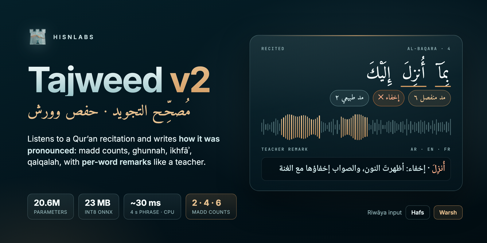
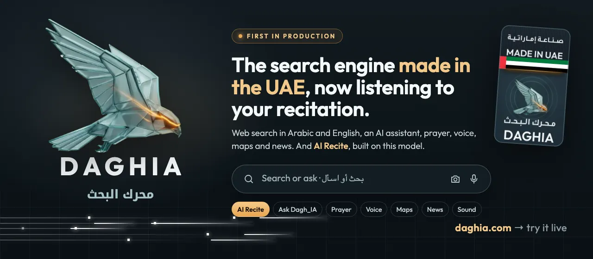
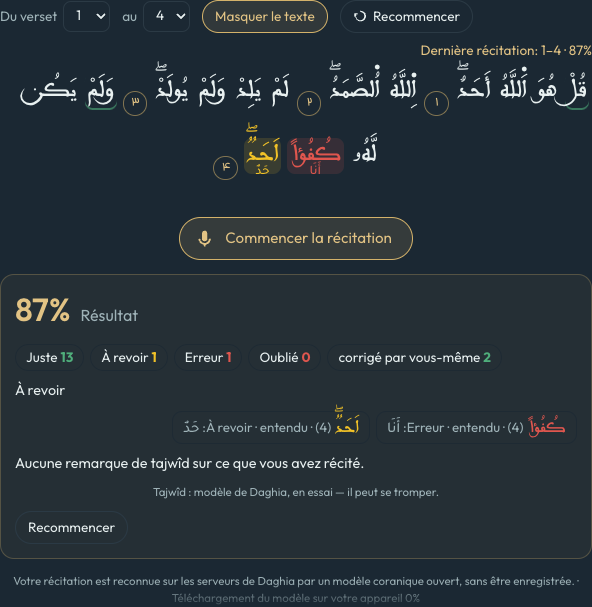
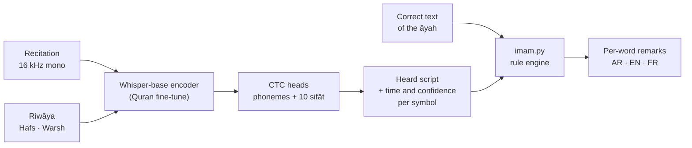

<p align="center">
  
</p>

<p align="center">
  <a href="https://daghia.com/?q=%D8%B3%D9%88%D8%B1%D8%A9+%D8%A7%D9%84%D9%83%D9%87%D9%81"></a>
  <a href="https://huggingface.co/Hisnlabs/tajweed-v2"></a>
  
  
  
  
</p>

# HisnLabs Tajweed v2

## First in production: Daghia

<p align="center">
  <a href="https://daghia.com"></a>
</p>

The first product built on this model is **[Daghia](https://daghia.com)** (<span dir="rtl">محرك البحث</span>), the search
engine made in the UAE. Daghia is an independent search engine, built as an alternative to the big global ones:
- web search in Arabic and English, by text, voice or camera;
- **Ask Dagh_IA**, its AI assistant;
- Prayer, Voice, Maps, News and Sound;
- and **AI Recite**: recite a surah from memory and get every word checked, with
  this model listening for tajweed.

### Try it live

1. Open a surah, for example **[سورة الكهف](https://daghia.com/?q=%D8%B3%D9%88%D8%B1%D8%A9+%D8%A7%D9%84%D9%83%D9%87%D9%81)**.
2. Click **AI Recite**, choose the verses, hide the text if you want to recite from memory, and start reciting.
3. When you finish, every word is marked: correct, to review, mistake, forgotten, or corrected by yourself. Tajweed
   remarks appear next to the word.

<p align="center">
  
  <br><sub>AI Recite after a recitation of Al-Ikhlas 1–4 (French interface). The word that was heard is shown under each flagged word.</sub>
</p>

## What the model does

**A small model that listens to a Qur'an recitation the way a teacher does.** It writes *how* each word was pronounced:
- how many counts each madd was held;
- whether the ghunnah was there, and whether the nūn was hidden (ikhfāʾ), turned to a mīm (iqlāb) or merged (idghām);
- whether ق ط ب ج د bounced (qalqalah).

The rule engine bundled with it then gives **per-word remarks** in Arabic, English or French, for **Hafs** or **Warsh**:

> <span dir="rtl"><b>أُنزِلَ</b> · إخفاء: أظهرتَ النون، والصواب إخفاؤها مع الغنة</span>
>
> *ikhfaʾ: the nun was pronounced clearly; hide it with ghunnah*

It runs on a CPU, in 23 MB, in about 30 ms for a 4-second phrase. No GPU and no cloud service are needed.

> ⚠️ **This model can be wrong.** It is a learning aid for self-study and review. It does **not** replace a qualified
> teacher (شيخ / مقرئ), and it must not be used to certify a reciter.

## At a glance

| | |
|---|---|
| **Task** | Tajweed-aware phonetic transcription of Qur'an recitation, plus per-word tajweed feedback |
| **Riwāyāt** | Hafs ʿan ʿĀṣim · Warsh ʿan Nāfiʿ (ṭarīq al-Azraq). The riwāya is an **input of the model**, not only of the rules |
| **Size** | 20.6 M parameters · 23 MB (ONNX int8) · 83 MB (fp32 / safetensors) |
| **Speed** | 28 ms for 4 s of audio, 74 ms for 10 s (Apple M1 Max, 2 CPU threads, int8) |
| **Madd** | Natural, muttaṣil, munfaṣil, lāzim, ʿāriḍ, līn, badal: **2 / 4 / 6 counts**, timed against the reciter's own pace |
| **Quality** | 7.0 % phoneme error rate on QDAT (159 learners, human labels) · madd length within ±1 count 95.9 % of the time |
| **Feedback languages** | Arabic · English · French |
| **Base** | Encoder of [tarteel-ai/whisper-base-ar-quran](https://huggingface.co/tarteel-ai/whisper-base-ar-quran), distilled from [obadx/muaalem-model-v3_2](https://huggingface.co/obadx/muaalem-model-v3_2) |

## How it works



1. **The model hears.** The encoder turns the audio into 50 frames per second. A CTC head writes the
   [Quran phonetic script](https://github.com/obadx/quran-transcript):
   - each long vowel is written once per count;
   - ghunnah, ikhfāʾ (`ں`), iqlāb (`۾`) and qalqalah (`ڇ`) have symbols of their own;
   - every symbol comes with a time and a probability.
2. **The rule engine compares.** `imam.py` builds what a correct recitation of the same words must sound like, under the
   chosen riwāya. It aligns the two and names each difference the way a teacher would. Remarks on sounds the model is
   unsure of are dropped.
3. **Madd is also measured in time.** The script stops at 4 symbols, so a 6-count madd is timed against the reciter's
   own natural madd (see *Madd measured in time* below).

The model does not decide *which words* were read. Give it the āyah, or pair it with a speech-to-text model (Daghia uses
Tarteel's Whisper).

## What it hears

| Area | What is checked |
|---|---|
| **Madd** | Natural (2), muttaṣil, munfaṣil, lāzim (6), ʿāriḍ, līn, badal and līn before a hamza (Warsh). Flags a madd that is too short, too long, dropped, or added where there is none. Also flags an *uneven* madd: the same madd must keep the same length throughout |
| **Nūn and mīm** | Ghunnah held too short · ikhfāʾ read as a clear nūn · missed iqlāb · missed idghām, with or without ghunnah · shadda not pronounced |
| **Qalqalah** | No bounce on ق ط ب ج د |
| **Clear mistakes (لحن جلي)** | Another letter, another vowel, a dropped sound, an added sound, a skipped word |
| **Waqf and ibtidāʾ** | Where the reader stopped and started again. Remarks then follow the pausal form (tanwīn → alif, ة → ه…) |
| **Warsh** | Badal 2/4/6, munfaṣil and muttaṣil 6, līn before a hamza 4/6, naql, ibdāl. The hamzas Warsh drops are not counted as mistakes |
| **Sifāt** *(PyTorch weights)* | 10 extra heads: hams/jahr, shidda/rakhāwa, tafkhīm/tarqīq, iṭbāq, ṣafīr, qalqalah, takrīr, tafashshī, istiṭāla, ghunnah |

### Example remarks

A learner reads Al-Baqara 4 and makes two mistakes:
- the first munfaṣil (بِمَآ) is held 2 counts and the second one 4;
- the nūn of أُنزِلَ is pronounced clearly instead of hidden.

These are the engine's own outputs:

| Word | العربية | English | Français |
|---|---|---|---|
| بِمَآ | <span dir="rtl">المد المنفصل: سوِّ بين المدود (2 / 4)</span> | separated madd (munfasil): keep the same length every time (2 / 4) | madd munfasil : garde la même longueur à chaque fois (2 / 4) |
| أُنزِلَ | <span dir="rtl">إخفاء: أظهرتَ النون، والصواب إخفاؤها مع الغنة</span> | ikhfaʾ: the nun was pronounced clearly; hide it with ghunnah | ikhfaʾ : le noun a été prononcé clairement ; il faut le cacher avec la ghunna |

Below, a **Warsh** recitation of the same āyah by Ibrahim al-Dosary, a reciter not used in training, with the madd
counts the engine measured:

```
heard: وَللَذِۦۦنَيُۥۥمِنُۥۥنَبِمَااااءُںںںزِلَءِلَيكَوَمَااااءُںںںزِلَ…
         بِمَآ  ok  [separated madd (munfasil): 6]
         وَمَآ  ok  [separated madd (munfasil): 6]
وَبِٱلَاخِرَةِ  ok  [madd after a hamza (badal): 4]
    يُوقِنُونَ  ok  [madd before a stop (ʿarid): 4]
```

## Quick start

The weights (ONNX and safetensors) are on Hugging Face: [Hisnlabs/tajweed-v2](https://huggingface.co/Hisnlabs/tajweed-v2).
This repository holds the code and the model card.

```bash
git clone https://github.com/HisnLabs/tajweed && cd tajweed
hf download Hisnlabs/tajweed-v2 onnx/model-int8.onnx --local-dir .   # 23 MB (pip install huggingface_hub)
pip install onnxruntime numpy faster-whisper quran-transcript levenshtein
ffmpeg -i recitation.mp3 -ar 16000 -ac 1 recitation.wav     # 16 kHz mono, one āyah or one phrase, ≤ 30 s

python inference.py recitation.wav 2 4                       # Hafs, Al-Baqara 4
python inference.py recitation.wav 2 4 --lang ar             # remarks in Arabic (ar · en · fr)
python inference.py recitation.wav 2 4 --warsh "وَالذِينَ يُومِنُونَ بِمَآ أُنزِلَ إِلَيْكَ …"   # Warsh: give the Warsh mushaf text
```

### From Python

```python
import wave, numpy as np
from inference import hear          # the model: audio -> tajweed-aware phonetic script
import imam                         # the rule engine: script -> per-word remarks
from quran_transcript import Aya

with wave.open("recitation.wav") as f:                  # 16 kHz mono 16-bit, one āyah
    audio = np.frombuffer(f.readframes(f.getnframes()), "<i2").astype(np.float32) / 32768

heard, probs, times = hear(audio, riwaya="hafs")      # script, per-symbol probability and time (s)
words = Aya(112, 1).get().uthmani.split(" ")
ref = imam.recited(words, heard, riwaya="hafs")
for w in imam.listen(ref, heard, heard_probs=probs, heard_times=times,
                     min_prob=0.3, min_prob_jali=0.7, langs=("en",)):
    print(w["word"], "ok" if w["ok"] else "✗",
          [f"{m['name']['en']}: {m['heard']}" for m in w["madd"]],
          [n["msg"]["en"] for n in w["notes"]])
```

### ONNX only

| | |
|---|---|
| Input `mel` | float32 `[batch, 80, frames]`: Whisper 80-bin log-mel of 16 kHz audio at its real length (no 30 s padding), an even number of frames, ≤ 3000 |
| Input `riwaya` | int64 `[batch]`: 0 = Hafs, 1 = Warsh |
| Output `logprobs` | float32 `[batch, frames, 43]`: one frame per 20 ms, index 0 = CTC blank, 1–42 = the symbols listed in `config.json` |

To read the output:
- **Script:** best-path decoding (argmax, collapse repeats, drop blanks).
- **Time:** each symbol's time comes from its frame index.

`inference.py` does both in about 20 lines.

## Model details

| | |
|---|---|
| Architecture | Whisper-base encoder (6 layers, d = 512), no decoder. A riwāya embedding is added to every frame, then 11 linear CTC heads (phonemes + 10 sifāt) |
| Parameters | 20,630,091 |
| Files | `onnx/model-int8.onnx` (23 MB, phoneme head) · `onnx/model-fp32.onnx` (83 MB) · `model.safetensors` (83 MB, all heads) · `config.json` · `modeling.py` (architecture) · `imam.py` (rule engine) · `warsh.py` (Warsh text → phonetizer) · `inference.py` |
| Frame rate | 50 per second (20 ms) |
| Speed (M1 Max, 2 threads, int8) | 4 s → 28 ms · 10 s → 74 ms · 25 s → 257 ms |
| Dependencies | onnxruntime, numpy, faster-whisper (its log-mel only). The rule engine adds quran-transcript and Levenshtein |

<details>
<summary><b>Training</b></summary>

- **Distillation.** The teacher is [obadx/muaalem-model-v3_2](https://huggingface.co/obadx/muaalem-model-v3_2), a
  600 M wav2vec2-BERT model with multi-level CTC ([paper](https://arxiv.org/abs/2509.00094), MIT). It labelled every
  clip with the phonetic script and the sifāt. The student learns all levels with a CTC loss.
- **Warsh labels.** The teacher and its phonetizer only know Hafs. For Warsh, the reference text is the King Fahd Warsh
  mushaf (quran-api `ara-quranwarsh`), rewritten for the phonetizer by `warsh.py` (99.8 % of āyāt covered).
- **Data: 27.7 k clips.**
  - Hafs professional recitations: everyayah, 13 reciters.
  - Learners' recitations: RetaSy quranic_audio_dataset.
  - Warsh professional recitations: Abdul Basit and Yassin al-Jazairi (everyayah), 10.5 k clips.
  - Held out for validation: Ibrahim al-Dosary (Warsh) and Khalid al-Qahtani (Hafs).
- **Augmentation.** Phone-like audio: 5–30 dB noise, 300–3400 Hz band, 8 kHz codec, random gain.
- **Run.**
  - Warm start from v1 (Hafs only), with the riwāya embedding initialised at zero.
  - 8 epochs on one NVIDIA L4, about 37 minutes.
  - AdamW: 5e-5 for the encoder, 1e-3 for the heads, cosine schedule.
  - The best epoch (6) was kept.

</details>

## Evaluation

| | v1 (Hafs only) | **v2** | teacher (600 M) |
|---|---|---|---|
| QDAT bench, phoneme error rate (159 learners, human labels) | 8.9 % | **7.0 %** | 4.9 % |
| QDAT bench, madd length within ±1 count | 87.9 % | **95.9 %** | 95.5 % |
| Held-out Hafs reciter, phoneme error rate | 4.3 % | **2.3 %** | — |
| Held-out Warsh reciter, phoneme error rate (median) | — | **0.0 %** | — |

With about 29 times fewer parameters than its teacher, v2 matches it on madd length and is 2.1 points behind on phoneme
error rate. The held-out reciters are scored against the teacher's transcripts, not against human labels.

**Remarks on correct recitations**: how often a word recited correctly by a professional still gets a remark (lower is
better).

| Recitation | Rules applied | Words with a remark |
|---|---|---|
| Held-out Warsh reciter | Warsh | **3.6 %** |
| Held-out Warsh reciter | Hafs (wrong riwāya selected) | 11.2 %. The extra remarks fall on Warsh's own features (badal, naql, ibdāl), which is why the riwāya input matters |
| Held-out Hafs reciter | Hafs | 8.9 % (v1: 9.8 %) |

### Madd measured in time (4 vs 6)

The phonetic script stops at 4 counts. On QDAT, every munfaṣil that the human labellers heard as **6** came out of the
model as 4. `imam.py` therefore also times any madd written with 4 or 5 symbols. It divides that time by the reciter's
own pace: half the median of their natural madds in the phrase, or across the session.

| QDAT munfaṣil, human label → | 2 | 4 | 6 |
|---|---|---|---|
| Symbols only → measured 2 / 4 / 6 | 35 / 2 / 0 | 3 / 86 / 0 | **0 / 6 / 0** |
| Symbols + time → measured 2 / 4 / 6 | 35 / 2 / 0 | 0 / 81 / 8 | **0 / 0 / 6** |

On the held-out Warsh reciter, munfaṣil and muttaṣil are always 6. With timing, **18 of 22** are measured as 6; without
it, none were. Natural madds stay at 2 (289 of 291).

## Limitations

- **Voices.** Most training audio is adult male professionals. Women's and children's voices come mostly from the
  learner data. Warsh has only two training reciters.
- **Inherited errors.** The model learns the teacher's transcripts, including the teacher's mistakes.
- **False remarks.** About 4–9 % of correctly recited words still get a remark (see above). Unsure remarks are dropped,
  but the engine can still correct a reciter who was right.
- **Madd 4 vs 6.** The timing is calibrated on 157 learners and one Warsh reciter. A very irregular pace (hesitation, a
  breath in the middle of a madd) can mislead it.
- **Audio.** Trained with phone-like augmentation. Very noisy rooms, music or several voices at once are out of scope.
- **Input length.** One āyah or one phrase per call, up to 30 s.

### Not covered yet

- Warsh **taqlīl / imāla**, **tarqīq of rāʾ** and **taghlīẓ of lām**.
- Warsh **ṣilat mīm al-jamʿ** before a hamza (6 counts).
- The six **badal exceptions** that stay at 2 counts (يؤاخذ، إسرائيل، القرآن…), and ع in كهيعص (4 or 6).
- Other riwāyāt (Qālūn, ad-Dūrī, Shuʿba…).

## Intended use

- **Self-study and memorisation review** (tasmīʿ): the learner recites, and the tool points at the words to check with
  a teacher.
- **Research** on Quranic pronunciation assessment, especially for Warsh.

**Out of scope:** certifying a reciter (ijāza), grading exams, or presenting the output as a teacher's judgement.

## Licence and attribution

| | |
|---|---|
| This model, rule engine and code | Apache-2.0 |
| Base encoder | [tarteel-ai/whisper-base-ar-quran](https://huggingface.co/tarteel-ai/whisper-base-ar-quran) (Apache-2.0) |
| Teacher labels | [obadx/muaalem-model-v3_2](https://huggingface.co/obadx/muaalem-model-v3_2) (MIT) |
| Phonetizer | [quran-transcript](https://github.com/obadx/quran-transcript) (MIT) |
| Benchmark | [obadx/qdat_bench](https://huggingface.co/datasets/obadx/qdat_bench) |
| Recitations | [everyayah.com](https://everyayah.com) · [RetaSy/quranic_audio_dataset](https://huggingface.co/datasets/RetaSy/quranic_audio_dataset) |
| Warsh text | [fawazahmed0/quran-api](https://github.com/fawazahmed0/quran-api) (`ara-quranwarsh`) |

With thanks to the authors of Quran Muaalem and quran-transcript, to Tarteel, and to the reciters and volunteers behind
these recordings.

## Citation

```bibtex
@misc{hisnlabs_tajweed_v2_2026,
  title  = {HisnLabs Tajweed v2: a small Hafs and Warsh Quran recitation listener with per-word tajweed feedback},
  author = {HisnLabs},
  year   = {2026},
  url    = {https://huggingface.co/Hisnlabs/tajweed-v2}
}
```

---

<p align="center"><sub>Made by <b>HisnLabs</b> (HISNLABS CYBER AI - FZCO, UAE) · used in <a href="https://daghia.com">AI Recite on daghia.com</a></sub></p>
